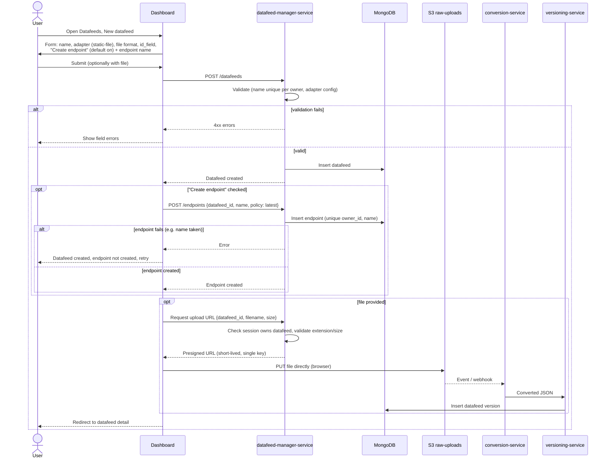

# 002 — Datafeed / Endpoint Domain Model

**Status:** Proposed
**Date:** 2026-10-06

## Context

Today an endpoint is created and fed directly by file uploads, and versions
are keyed by `endpoint_name`. We want to separate *where data comes from* from
*how it is exposed*.

## Decision

Two domain objects:

- **Datafeed** — a named, user-owned source of data. A datafeed uses exactly one
  **adapter**, which converts static or dynamic source data into the domain's
  data object (JSON). Each refresh/upload produces a new **datafeed version**.
- **Endpoint** — fetchable content exposed online. It references a datafeed and
  either follows its latest version or pins a specific one.

### Adapters

An adapter is responsible only for source → domain data object conversion.

| Adapter | Description | Phase |
|---|---|---|
| `static-file` | Converts an uploaded file (CSV, JSON, XML, XLSX, ...) | 1 (current) |
| `cron-download` | Periodically downloads a URL and converts it | Later |
| `database` | Reads a SQL/NoSQL table/collection and converts it | Later |

### Relationships

- Target model (later): datafeed N:M endpoint; endpoints may transform content
  (subset, rename, join across datafeeds).
- **Phase 1 constraint: one datafeed per endpoint, passthrough.** A datafeed may
  already serve several endpoints (1:N); an endpoint uses exactly one datafeed.
  No transformations.

### Versioning

Versions live on the **datafeed**. An endpoint has `version_policy`:
`latest` (default) or `pinned` with `{major, minor}`.

### Ownership

A new Go service, `src/datafeed-manager-service`, owns datafeed and endpoint
definitions and adapter execution. The dashboard calls it. Existing
`conversion-service`, `versioning-service` and `datafeed-service` keep their
roles but must be re-keyed from `endpoint_name` to datafeed (see migration).

### Draft schemas (MongoDB)

```ts
datafeeds: {
  _id, owner_id, name, description,
  adapter: "static-file",
  adapter_config: object,   // static-file: { format, id_field? }
  created_at, updated_at
}
// unique (owner_id, name)

endpoints: {            // existing collection, extended
  _id, owner_id, name,
  datafeed_id,
  version_policy: { mode: "latest" | "pinned", major?, minor? },
  created_at, updated_at
}
// unique (owner_id, name)

uploads: {              // tracks presigned uploads for cleanup
  _id, key, owner_id, datafeed_id,
  status: "pending" | "processed" | "rejected" | "expired",
  created_at, updated_at
}
// unique (key); index (status, created_at)

versions: {             // ADR 001, extended
  datafeed_id,          // replaces endpoint_name as the FK
  ...
}
```

### Migration

Each existing endpoint gets an auto-created `static-file` datafeed with the
same name and owner; its versions are re-keyed to that datafeed; the endpoint
points at it with `version_policy.mode = "latest"`. The migration must be
idempotent. Public URLs move to `/<user_name>/<endpoint_name>`; the legacy
`/{endpoint_name}` route is retired (no alias).

## Consequences

- ADR 001's `versions.endpoint_name` FK is superseded by `datafeed_id`.
- Secrets for sources (DB strings, auth headers) are not stored in phase 1
  because only `static-file` exists.

## Resolved decisions

- Service name: `src/datafeed-manager-service`.
- With the `static-file` adapter the browser uploads the file directly to S3
  `raw-uploads` using a presigned URL issued by the manager service (see
  "Upload security"). File bytes never pass through the manager service. The
  existing conversion -> versioning pipeline produces the version. The manager
  service owns datafeed/endpoint definitions and issues upload URLs.
- Endpoint names are unique per user, like GitHub repositories, and are
  exposed under the owner's username (usernames are immutable):
  - latest: `<domain>/<user_name>/<endpoint_name>`
  - by version: `<domain>/<user_name>/<endpoint_name>/version/<version>`
- `<version>` is `<major>.<minor>` matching `^[0-9]+\.[0-9]+$` (e.g. `1.3`);
  anything else is a 404. It maps to `versions.major`/`minor`.
- The legacy `/{endpoint_name}` route in `datafeed-service` is retired, no alias.
- `datafeed-service` (read API) resolves endpoint -> datafeed -> version itself
  by reading MongoDB. It stays read-only with no runtime dependency on the
  manager, keeping the hot path to one hop.
- UI: Stitch screens are generated before building the UI.

## Upload security

The browser uploads with a presigned URL (SAS-style) issued by the manager
service. Requirements:

- **Authorization first:** issue a URL only if the session user owns the
  datafeed. The owner comes from the session, never from the request body.
- **Server-chosen key:** `raw-uploads/<owner_id>/<datafeed_id>/<uuid>`; the
  client cannot choose or overwrite keys. The original filename is metadata only.
- **Scope:** one object, `PUT` only, no list/read/delete.
- **Short expiry:** 5 minutes, single use intent; issued per upload, never cached.
- **Limits:** max size and allowed extensions/content types fixed per adapter
  format. Prefer a presigned POST policy (`content-length-range`, content-type
  condition); if SeaweedFS does not enforce policy conditions, sign the exact
  `Content-Length` and `Content-Type` headers and enforce size in the pipeline.
- **Never trust the client:** conversion-service re-validates format and size
  and rejects bad objects; rejected objects are deleted.
- **Bucket hygiene:** `raw-uploads` stays private (no public read), CORS allows
  only the dashboard origin and `PUT`/`POST`, HTTPS in non-local environments.
- **Credentials:** the signing key is a dedicated S3 identity limited to
  `raw-uploads` write; the admin identity is not used (backlog: per-app S3
  credentials).
- **Cleanup of unprocessed uploads:** a bucket lifecycle rule cannot tell
  processed from unprocessed objects (both live under the same prefix), so the
  manager service tracks uploads:
  - Issuing a URL inserts `uploads {key, owner_id, datafeed_id, status:
    "pending", created_at}`.
  - Status becomes `processed` when a version with that `source_upload_key`
    exists, and `rejected` when conversion fails validation (conversion-service
    also deletes the object immediately). Processed raw files are kept: they
    are the version's source (`versions.source_upload_key`).
  - A periodic sweeper inside the manager service (no new infrastructure)
    runs daily and deletes objects whose upload is still `pending` after 24h
    (longer than URL expiry plus pipeline time), then marks them `expired`.
  - The sweeper also lists `raw-uploads` and deletes objects with no `uploads`
    record older than 24h (e.g. a record insert that failed).
  - Deleting a datafeed deletes its versions and raw objects.
  - Sweeper runs are idempotent and log counts of deleted objects.
- No rate limiting or antivirus in phase 1 (not required yet; revisit).

## Flow: create a datafeed (with optional endpoint)

The creation form has an "Also create an endpoint" option, on by default.
It carries the endpoint name (defaults to the datafeed name). The datafeed is
created first; the endpoint is created only after it succeeds. If the endpoint
step fails, the datafeed is kept and the user is told the endpoint was not
created, with a retry from the datafeed page. An endpoint on a datafeed with no
version yet serves nothing until the first upload completes.


